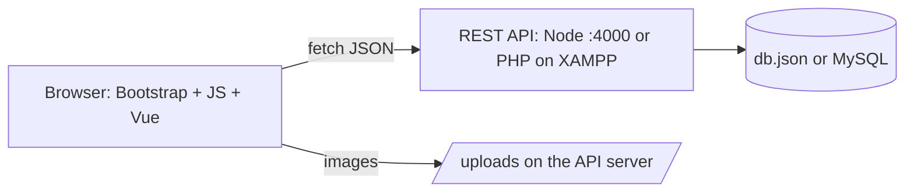
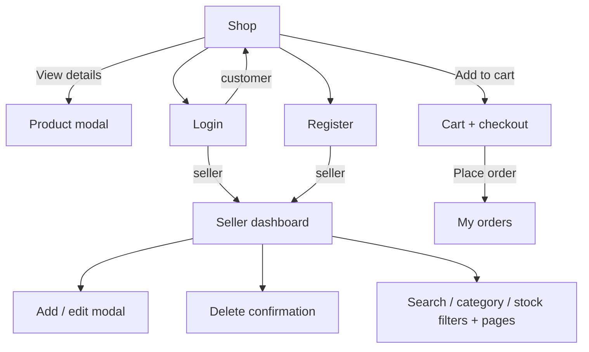

# Palengke Online — Front-End

Version 1.0 · <date> · Author: <your name>

The customer and seller website for Palengke Online, a local produce marketplace. It is built from the designer's mockups and uses the back-end team's REST API.

## 1. Target audience

- **Front-end and back-end developers:** setup, architecture, API use (sections 3, 4, 6, 7).
- **Customers and sellers:** how to use the site (section 5).
- **Project manager / assessor:** scope, features, tests (docs/TEST-PLAN.md), risks (docs/RISK-ASSESSMENT.md).

## 2. Scope

Covers the six pages (Shop, Log in, Register, Cart and checkout, My orders, Seller dashboard), how they call the API, and how to run them. The API itself is documented by the back-end team in `API.md`.

## 3. System architecture

```
Browser (HTML5 + Bootstrap 5 + JavaScript, Vue.js for one component)
   │  fetch() with JSON, "Authorization: Bearer <token>" on protected calls
   ▼
Palengke Online REST API  (Node.js http://localhost:4000/api  or  PHP on XAMPP http://localhost/palengke-api/api)
   ▼
Data store (Node: data/db.json · PHP: MySQL database "palengke")
```

- `js/api.js` is the only place that talks to the API: `apiFetch(path, method, body, useToken)` adds the headers and the token, and throws an error with `message`, `status` and `errors` (per field) when the API answers with an error.
- Each page has its own script: `shop.js`, `login.js`, `register.js`, `cart.js`, `orders.js`, `seller.js`.
- `api.js` also draws the navbar for the logged-in user (`renderNavUser`), including the customer's cart count (`loadCartCount`).
- `js/vue-summary.js` is the Vue.js inventory summary on the seller dashboard.
- The login session (token, expiry, user) is kept in `sessionStorage` for the current browser tab only.

## 4. Installation and setup

Requirements: Node.js LTS (or XAMPP for the PHP API), VS Code with Live Server, a modern browser.

1. Start the API: `cd api-server` then `node server.js` (it listens on `http://localhost:4000`). Or use the PHP version on XAMPP (`api-php/README.md`) and switch the `API_BASE` line in `js/api.js`.
2. Open `index.html` with **Live Server**. Opening the file directly (`file://`) does not work.
3. Sample logins: seller `maria@example.com` / `Seller123`; customer `juan@example.com` / `Customer123`.

Release copy: `sh release.sh` (macOS/Linux) or `powershell -ExecutionPolicy Bypass -File release.ps1` (Windows) builds a minified copy in `release/`; serve it with `http-server release -p 8081`. Needs `npm install -g terser clean-css-cli html-minifier-terser http-server`. Results are in `docs/PERFORMANCE.md`.

Configuration: `API_BASE` in `js/api.js`. When the API moves, change it there **and** in the `connect-src` and `img-src` parts of each page's Content Security Policy.

## 5. Features

| Page | Feature | API |
|---|---|---|
| Shop | product cards with photo, category, seller, price and stock | `GET /api/products`, `GET /api/categories` |
| Shop | search, category, price range, sort, pages | query options on `GET /api/products` |
| Shop | product details in a modal | `GET /api/products/:id` |
| Shop | **Add to cart** on each card and in the details window (with a quantity); a toast confirms it; the navbar cart badge updates. Visitors are sent to log in; sellers get no buy buttons | `POST /api/cart` |
| Cart | the cart lines with photo, price, quantity box and Remove; items and total | `GET /api/cart`, `PUT` / `DELETE /api/cart/:product_id` |
| Cart | **checkout**: delivery address and notes, Place order (cash on delivery); stock problems are shown and the cart reloads | `POST /api/orders` |
| My orders | every order, newest first, with its items, address, notes and total; a thank-you message after checkout | `GET /api/orders` |
| Log in | log in; the role decides where you go next | `POST /api/auth/login` |
| Register | customer or seller account; the API's errors are shown under each field | `POST /api/auth/register` |
| All pages | name, role badge and Log out in the navbar | `POST /api/auth/logout` |
| Seller dashboard | own products in a table, 8 per page, sorted by name; add, edit, delete in modals | `GET /api/seller/products`, `POST`, `PUT`, `DELETE /api/products/:id` |
| Seller dashboard | **search, category and stock filters** with a product count and page buttons | `GET /api/seller/products?search&category_id&stock&page&sort=name` |
| Seller dashboard | photo upload with preview (JPG/PNG/WebP, 2 MB); the API saves it under a UUID name; remove the photo when editing | `multipart/form-data` on `POST` / `PUT /api/products` |
| Seller dashboard | inventory summary (Vue.js): products, units, stock value, out of stock | `GET /api/seller/summary` |

Responsive with the Bootstrap grid: product cards 1 / 2 / 3 per row; filters fold away on phones; the seller table hides the Category column and stacks its buttons on phones.

## 6. API endpoints used (checked with `api.http`)

| Method | Endpoint | Auth | Used by | Handled errors |
|---|---|---|---|---|
| GET | /api/categories | – | shop, seller | network error |
| GET | /api/products?search&category_id&min_price&max_price&sort&page | – | shop | 422, network error |
| GET | /api/products/:id | – | shop | 404 |
| POST | /api/auth/login | – | login | 401, 422 |
| POST | /api/auth/register | – | register | 422 (shown per field) |
| POST | /api/auth/logout | Bearer | navbar | 401 (ignored) |
| GET | /api/seller/products?search&category_id&stock&page&sort | Bearer (seller) | seller | 401 → login page |
| GET | /api/seller/summary | Bearer (seller) | Vue summary | "Summary unavailable." |
| GET | /api/cart | Bearer (customer) | navbar badge, cart | 401 → login page |
| POST | /api/cart | Bearer (customer) | shop | 401 → login page, 422 (stock) in a toast |
| PUT | /api/cart/:product_id | Bearer (customer) | cart | 422 (stock) in an alert, old quantity put back |
| DELETE | /api/cart/:product_id | Bearer (customer) | cart | 401, 404 |
| POST | /api/orders | Bearer (customer) | cart (checkout) | 422 per field; `errors.cart` in an alert |
| GET | /api/orders | Bearer (customer) | My orders | 401 → login page |
| POST | /api/products (multipart/form-data with `image`) | Bearer (seller) | seller | 401, 403, 413, 422 |
| PUT | /api/products/:id (multipart/form-data) | Bearer (seller) | seller | 401, 403, 404, 413, 422 |
| DELETE | /api/products/:id | Bearer (seller) | seller | 401, 403, 404 |

## 7. Code documentation

Every JavaScript file starts with a comment that says what it does and which API endpoints it uses; every function has a comment above it saying what it does. The code is written in a simple style (plain `function`, `if/else`, `for` loops) so it is easy to read and explain.

## 8. Diagrams




